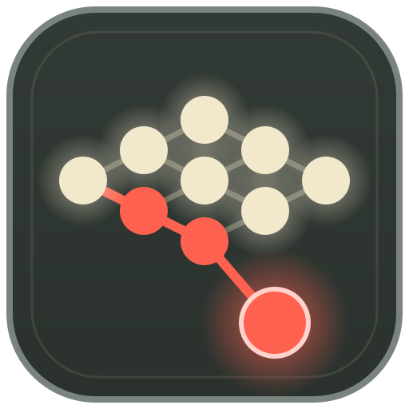
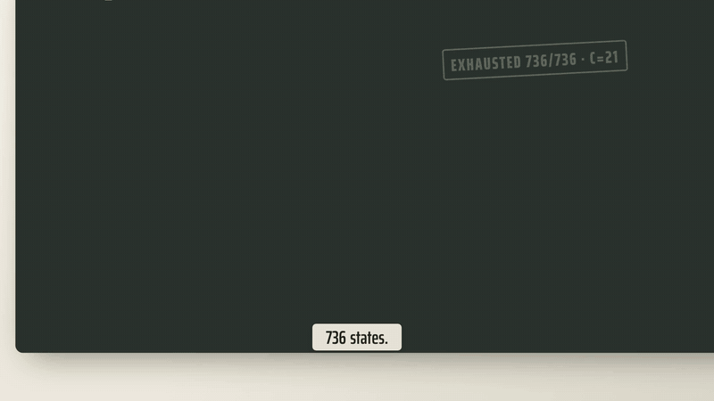
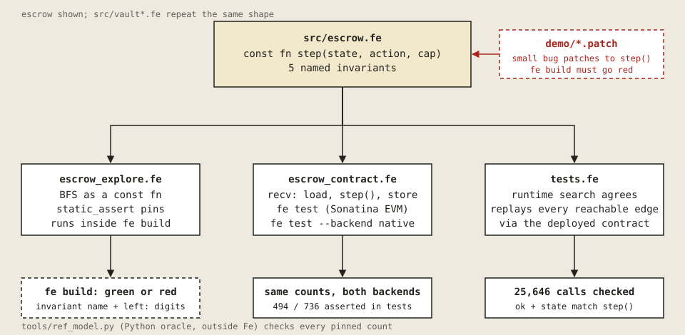

<div align="center">
  
  <h1>exhaust 🔦</h1>
  <p><em>The Fe compiler is the model checker: every reachable state of a protocol model, up to a stated capacity, explored inside <code>fe build</code>. The escrow: 736 states at capacity 21, in 940,335 of the 1,000,000 steps one assert may spend.</em></p>
  

  <br/>

  [](https://fe-lang.org/contest/)
  [](DEMO.md)
  [](evidence/)
  [](https://exhaust.edycu.dev/)
  [](https://exhaust.edycu.dev/deck/)

  <br/>

  
  
  
  [](LICENSE)

</div>

---

**Fe contract authors and auditors can miss the sequence nobody wrote a test for** (Deposit, Deposit, Lock, Release, Refund pays
both sides); `exhaust` finds it inside the build they already run. A `const fn` explores every reachable state of the
model inside `fe build`, at a stated capacity: the escrow at C = 21 units, **all 736 reachable states and every accepted
transition checked against five named invariants**. Break the model and the build fails: the compiler names the invariant
and prints a shortest counterexample as action digits.

**The ceiling, on the first screen.** Fe 26.6.0 gives each `static_assert` evaluation 1,000,000 evaluator steps and a
recursion limit of 64, with no CLI or config override. The C = 21 search uses **940,335** of them (86,323 to set up its tables,
then about 1,160 per state; `evidence/bench-2026-11-20.md`). Consts that reference other consts share one budget, so a
larger model is split into independent asserts, never chained (`evidence/budget.md`).

This is bounded-exhaustive checking at the stated capacities (the small-scope hypothesis), not formal verification; what it
does not cover is listed under [Limitations](#limitations-what-this-does-not-prove). For the nine bugs we planted, an
independent Python re-count of the model (`tools/ref_model.py`) shows each one already breaking an invariant at escrow
capacity 1 or 2, or vault balance 1 or 2, and the demo route `11234` is the same at capacity 2 as at 21
(`evidence/small-scope.txt`): an illustration of the hypothesis on this zoo, not evidence about bugs nobody planted. C = 21 is how far one assert can count, not what the demo bug needs.

## 📸 See it in Action

<p align="center"></p>
<p align="center"><sub>From the demo video, trimmed to 26 s: real <code>fe 26.6.0</code> output. One condition removed, the build fails naming the invariant and printing <code>11234</code>, decoded on the committed state graph (<code>evidence/state-graph-escrow.json</code>).</sub></p>

Try it (macOS Apple Silicon or Linux x86-64; git, curl and patch):

```sh
git clone https://github.com/edycutjong/exhaust && cd exhaust
curl -fsSL https://raw.githubusercontent.com/argotorg/fe/v26.6.0/feup/feup.sh | bash -s -- --version v26.6.0 --no-modify-path
export PATH=$HOME/.fe/bin:$PATH # this shell only: repeat it in every new terminal
fe --version                  # fe 26.6.0 (5b3f96a)
fe build                      # the compile-time search: green (736 states at C = 21)
sh demo/run.sh                # one-line bug in the Refund guard: red, with the invariant and the digits
fe test                       # Sonatina (EVM) backend: 28 tests
fe test --backend native      # native backend: 10 tests (Linux needs a C linker: apt-get install gcc libc6-dev)
```

`demo/run.sh` (transcript: `evidence/demo-run.txt`) builds the escrow green, applies a one-line bug to the Refund guard,
builds again and fails:

```text
error[3-0036]: assertion failed in const context
= assertion message: invariant 'paid once' broken: buyer and seller both paid
error[8-0081]: static assertion failed
= left: `11234`        # 1 Deposit . 1 Deposit . 2 Lock . 3 Release . 4 Refund
```

It then replays that attack on the patched contract (all five calls accepted: seller and buyer both paid) and on the real
one (the Refund is refused, storage unchanged). It works on temporary copies, so your checkout is never patched. To break
it by hand: delete `&& s.seller == 0` from the Refund guard in `src/escrow.fe`, run `fe build`, then
`git restore src/escrow.fe` before `fe test` (a failed `static_assert` stops `fe test` from running at all).

## 💡 The Problem & Solution

### The Problem

A protocol state machine (escrow, vault, timelock) fails in the sequences nobody wrote a test for: Deposit, Deposit, Lock,
Release, then Refund pays both sides. Unit tests check the paths an author imagined; a model checker explores all of them,
but it is a separate tool, a separate language and a separate step that the contract's own build never runs.

### The Solution

`exhaust` moves the search into the compiler. The model is ordinary Fe: a `const fn` breadth-first search calls `step()` on
every state it reaches and `static_assert`s the reachable count and the invariants. If a patch to `step()` breaks an
invariant, `fe build` fails and prints the attack. The same `step()` runs in the contract's `recv` handlers, so for the escrow the function
that was checked is the function that is deployed (the vault's caller and timelock checks are adapter code, see below).

| Bug patch (`demo/`) | Invariant named | Counterexample (`left:`) | Decoded |
|---|---|---|---|
| `refund-after-release` | `paid once` | `11234` | Deposit, Deposit, Lock, Release, Refund |
| `settle-early` | `settled empty` | `1123` | Deposit, Deposit, Lock, Release |
| `mint-release` | `conserved` | `123` | Deposit, Lock, Release |
| `cap-off-by-one` | `within capacity` | `11111111111111111111` | twenty Deposits |
| `vault-approve-twice` | `counted once` | `122` | Propose, ApproveA, ApproveA |
| `vault-execute-early` | `timelock respected` | `1236` | Propose, ApproveA, ApproveB, Execute |
| `vault-pay-twice` | `pays one unit` | `1235556` | Propose, ApproveA, ApproveB, Tick, Tick, Tick, Execute |
| `vault-cancel-pays` | `only execute pays` | `17` | Propose, Cancel |
| `vault-execute-unguarded` | `two distinct approvals` | `6` | Execute |

All nine are checked by `sh demo/check-bugs.sh` (transcript: `evidence/check-bugs.txt`); a native trace by action name is
`sh tools/trace.sh demo/refund-after-release.patch`, and `python3 tools/decode-trace 1236 --protocol vault --bug vault-execute-early`
decodes digits.

## 🏗️ Architecture & Tech Stack

<p align="center"></p>

| Layer | What |
|---|---|
| Language | Fe 26.6.0 (`fe 26.6.0 (5b3f96a)`), one ingot (`fe.toml`) |
| Model | `src/escrow.fe`, `src/vault.fe`: state, actions, `step()`, invariants (`MODEL.md` says it in words) |
| Search | `src/escrow_explore.fe`, `src/vault_explore.fe`: `const fn` BFS, `static_assert` pins, shards |
| Contract | `src/escrow_contract.fe`, `src/vault_contract.fe`: `recv` handlers calling `step()` |
| Backends | Sonatina (EVM) and native, both via `fe test` |
| Oracle | `tools/ref_model.py`, stdlib Python, written outside Fe |

Two protocols: the escrow (Deposit, Lock, Release, Refund, Dispute) and a 2-of-3 approval vault with a timelock (B = 10,
T = 3: 211 states, ten invariants including `only execute pays`). Liveness is not checked.

## 🏆 Fe Integration

Remove Fe and nothing is left. The core flow uses: `const fn` with `while` loops, mutable locals and array index writes
(since Fe 26.1.0) evaluated under `static_assert`; `static_assert` as the build gate, sharded across independent asserts;
const-context `assert!` messages as named invariants; enums with `match`, `impl Copy` structs; `contract` with `msg` / `recv`
handlers calling the shared `step()`; `fe test` on both backends with `black_box` and a gas event; `#[cfg(target = "evm")]`;
a proper ingot and `fe fmt --check`.

```fe
// src/escrow_explore.fe, explore_seeds (explore calls it): a breadth-first search in a const fn, every action from every state
while head < tail {
    let x = queue[head]
    head += 1
    let cur = decode(x)
    var a: u32 = 0
    while a < ACTIONS {
        let act = action_of(a)
        let n = step(cur, act, cap)
        if n.ok {
            // Every invariant is checked before `encode`, so an out-of-box successor fails by name.
            let v = first_violation(cur, act, n.s, cap)
            if v != OK { require(v) }
            let y = encode(n.s)
            if !visited[y as usize] {
                visited[y as usize] = true
                queue[tail] = y
                tail += 1
            }
        }
        a += 1
    }
}

// the build fails if the reachable-state count drifts, or any invariant breaks on the way
static_assert(explore(17) == 494)
static_assert(explore(CAP) == STATES)       // CAP = 21, STATES = 736
```

**How Fe is used here.** The explorer is a `const fn` with loops and array writes, evaluated by the compiler under
`static_assert`; the transition function it calls, `step()`, is the very same function the `recv` handlers and the tests
call on two backends. We did not compare this against other contract languages or model checkers: this describes what
this build does, not how it ranks.

**Neighbours, for orientation (we did not benchmark against any of them).** Solidity's compiler ships a checker,
[SMTChecker](https://docs.soliditylang.org/en/latest/smtchecker.html), that reasons symbolically with SMT and Horn
solvers; [Foundry invariant tests](https://www.getfoundry.sh/guides/invariant-testing) run random call sequences and check
invariants after each call; [Echidna](https://github.com/crytic/echidna) generates random call sequences and checks that
each invariant holds;
[halmos](https://github.com/a16z/halmos) tests EVM contracts symbolically. exhaust is an explicit-state search written in
ordinary Fe (no solver, no annotation language, no random sampling): the compiler's const evaluator enumerates every
reachable state at a stated capacity, over the same `step()` the contract calls, and the bound is part of the claim.

### What this taught us about Fe's const evaluator (26.6.0)

- Each `static_assert` gets its own 1,000,000 steps, but consts that reference other consts share one budget: split a
  search across independent asserts, never chain them (`evidence/budget.md`).
- Every function call costs steps. Writing `step()` and the invariant check without helper calls cut the explorer to about
  1,160 steps per state and moved the largest capacity that fits one assert from 19 to 21.
- Array initialisation costs about one step per element, so the visited table counts against the same budget.
- There is no step counter to read: `bench/budget_probe.py` measures a search by bisecting a burn loop in the same assert
  (one bare loop iteration costs about 23 steps).
- A failed `static_assert` stops `fe test` from running at all, so tests of a deliberately broken model run in a temp copy
  with the pins removed (`demo/run.sh`, `demo/check-bugs.sh`). The full friction log is `FE-NOTES.md`.

### Use the pattern on your own model

1. Write the protocol as one `step(state, action)` over an `impl Copy` state struct and an action enum, with the
   invariants as one predicate in `src/escrow.fe` (explained in `MODEL.md`) and their `assert!` messages in
   `src/escrow_explore.fe`.
2. Copy the explorer (`src/escrow_explore.fe`): an encoding into a table index, a breadth-first `while` loop, and
   `static_assert` pins on the reachable count. Cross-check every pin with a model written outside Fe (ours:
   `tools/ref_model.py` re-counts all of them and supplied the edge pins), so the explorer never vouches for itself.
3. Size it before you trust it: `bench/budget_probe.py` measures how many of the 1,000,000 steps each search here uses (by
   bisecting a burn loop); edit its `SEARCHES` list and `HEADER` to point it at yours. If it does not fit, split by
   independent start states into separate asserts.
4. Point the contract's `recv` handlers at the same `step()`, and replay every reachable edge through the deployed contract
   (`src/tests.fe`, `test_differential_all_edges`).
5. Plant bugs as small patches in `demo/` (six of our nine are one line) and list them in `demo/bugs.tsv`;
   `sh demo/check-bugs.sh` passes only when every patched build fails. The vault took this route: `evidence/transfer-vault.md` records what changed and what did not.

## 📊 Engineering Rigor

| What | Number | Evidence |
|---|---|---|
| Escrow reachable states (C = 21) | 736, 966 accepted edges, 3,680 attempts, depth 43 | `evidence/bench-2026-11-20.md` §1 |
| Compile-time step budget (C = 21) | 940,335 of 1,000,000 (94.0%) | `evidence/budget.md` |
| Attack printer (C′ = 19) | 908,455 steps (90.8%); C′ = 20 fits at 98.4% | `evidence/capacities.md` |
| Vault (B = 10, T = 3) | 211 states, 580 edges, 586,715 steps (58.7%) | `evidence/bench-2026-11-20.md` §5 |
| Independent oracle | agrees with all 15 Fe pins (8 escrow, 7 vault) and the 3,680-row edge table | `evidence/oracle.txt` |
| Differential (C = 21) | 1,008 deployments, 25,646 calls, every ok + state matched against `step()` | `evidence/differential.txt` |
| Runtime search gas, same explorer (C = 17) | 16,394,182 (494 states) | `evidence/gas.txt` |
| Bug zoo | 9 of 9 patches fail `fe build` naming the invariant | `evidence/check-bugs.txt` |

C = 21 is the largest capacity the encoding holds; the largest independent shard at C = 21 is 385 states. Wall times are in
the benchmark file with the machine and load noted: at these sizes they carry little signal, the step budget is the cost
that decides what fits.

### Limitations: what this does not prove

In short: only the stated capacities are explored; no liveness; the escrow model has no caller identity and moves no value; the
model, the Fe code and the oracle share one author. Details:

- Everything is measured on Fe 26.6.0 (`fe 26.6.0 (5b3f96a)`), the version this entry pins. Fe 26.7.0 (2026-11-18) was not re-measured; its
  CTFE budget in the source is the same 1,000,000 steps and recursion 64.
- Only the stated capacities are explored (C = 21 for the state count, C′ = 19 for the printed trace); behaviour above them is
  not checked. Liveness is not checked, only safety invariants.
- The escrow model has no caller identity: `msg.sender` authorization is not modelled. Units are abstract counters: no ETH or
  token moves, so value transfer, reentrancy and gas are out of scope.
- The contracts are model-faithful demonstrators, not custody contracts, and a rejected transition returns `false` instead of
  reverting. The escrow has no access control (any address can call any handler). The vault checks the caller in adapter code
  outside the compile-time check: ApproveA / B / C only from the stored signer, Propose and Cancel from any one signer, Execute
  from anyone. So a single signer can cancel any pending withdrawal, also a queued one, and keep the vault from paying out
  (censorship; liveness is not checked).
- The differential test covers every transition reachable through the handlers at C = 21; storage states the handlers cannot
  reach (an upgrade, a storage collision) are not covered.
- `MODEL.md`, the Fe model and the oracle share one author and one reading of the protocol. The oracle is independent in
  language and state representation (Python tuples; its escrow edge table packs states differently), but its edge hashes use
  the Fe index formulas (radix 22 for the escrow, the vault's mixed radix for the vault). A misreading shared by all three is not
  caught.
- The vault (second protocol, `MODEL.md`) is explored at B = 10 with T = 3, plus T = 1, T = 2 and a B = 8, T = 2 baseline as separate
  models. Its contract has no `Tick` handler and the `fe test` harness can neither move the block time nor change the caller, so the
  contract's own graph has 91 states (lock period passed) and 9 (a lock that never passes) against the model's 211, and the vault
  differential replays exactly those; all three signers are one address in the differential. Caller authorization is tested only
  from the refusing side (`test_vault_identity_guards`: signer A's ApproveB / ApproveC and a non-signer's Propose are refused, nothing
  stored changes); an accepted approval from a second address, a refused non-signer Cancel and signer distinctness are untested, and
  `init` does not require the three signer addresses to differ.
- The vault's real timelock is adapter code, not the checked model: Execute sets the model's clock to T once
  `now >= queued_at + lock`, so `timelock respected` holds for the contract only as far as that line is right, and a deployer's
  `lock` of zero makes it vacuous. Tests use a lock of zero (the equality side of `>=` is exercised: a `>` there fails three tests, conformance K8)
  or one that never passes; where `queued_at` is set and the `lock − 1` side are untested, and `init` does not bound `lock`.
- `in bounds` cannot fire first for this escrow (`within capacity` implies it); it guards the encoding for future edits. The vault's
  `two distinct approvals` is defence in depth the same way: it fires first only if Execute loses its phase, quorum and timelock
  guards together (`demo/vault-execute-unguarded.patch`: the build names it and prints `6`).
- The escrow's `conserved` bounds the total only: it does not catch a Release or Refund that moves two units at once. The vault checks the size of each payout (`pays one unit`) and that nothing but Execute pays (`only execute pays`).

Action legend: 1 Deposit · 2 Lock · 3 Release · 4 Refund · 5 Dispute (vault: 1 Propose · 2 ApproveA · 3 ApproveB · 4 ApproveC ·
5 Tick · 6 Execute · 7 Cancel). A printed `9` means the start state itself breaks an invariant (no action). The model in words: `MODEL.md`. Numbers: `evidence/`.

## 🚀 Getting Started

### Prerequisites

git, curl, patch; python3 only for the oracle and the decoder. On Linux the native backend also needs a C linker
(`apt-get install gcc libc6-dev`). Fe is installed by the pinned line above; nothing is added to your shell profile.
The full local CI run (`sh tools/ci_local.sh`) also needs `gitleaks` (for `tools/leak_scan.sh`) and `actionlint`; without
`actionlint` it reports that step as skipped and exits 3.

### Installation

See the 60-second block under "See it in Action". `fe build` is the check; `sh demo/run.sh` is the demo.

## 🧪 Testing & CI

```sh
fe fmt --check
fe test                               # 28 tests, Sonatina (EVM) backend
fe test --backend native              # 10 tests, native backend
sh tools/differential.sh              # the exhaustive-edge differential report (also part of fe test)
sh tools/transition_coverage.sh       # replayed edges vs the oracle's reachable edges (no line-coverage tool exists in Fe 26.6.0)
sh demo/check-bugs.sh                 # every bug patch must fail fe build naming its invariant and printing its digits
sh demo/check-bugs.sh --conformance   # the checker's own negative tests
python3 tools/ref_model.py --check    # the Python oracle against every pin
sh bench/run.sh --quick               # bench smoke: gated on the step-limit rows
sh tools/leak_scan.sh                 # gitleaks over the whole history + no kitchen file tracked
sh tools/ci_local.sh                  # the CI workflow's steps, run locally
```

`.github/workflows/ci.yml` defines the same steps on a pinned Fe (every action pinned to a commit SHA) as parallel jobs: **Quality** (`fe fmt --check`, `fe check`),
**Build** (`fe build`, artifacts listed and uploaded), **Test** (`fe test` on Sonatina and `fe test --backend native`, as a
matrix), **Must-fail** (`demo/check-bugs.sh`: the job passes only when every patched build fails naming its invariant and
printing its digits, and `--conformance` does the same for the checker's own mutants; a table that runs no rows fails), **Oracle** (the Python model against
every pin), **Bench smoke** (`bench/run.sh --quick`, gated on the step-limit rows) and **Transition coverage**.
`security.yml` runs gitleaks (tarball checksum-verified) over the full history and CodeQL for what it supports here (the workflow files and the Python
under `tools/` and `bench/`; CodeQL has no Fe extractor). `release.yml` derives the next version from Angular-style commit
prefixes; the first release is `v0.1.0`. Dependabot watches the GitHub Actions the workflows use (the ingot has no third-party dependencies
for it to watch).

**Coverage.** Fe 26.6.0 has no line-coverage tool, so none is claimed. The measurable coverage is over transitions:
`sh tools/transition_coverage.sh` replays the oracle's reachable transitions through the deployed contracts and reports
replayed against reachable, from the tests' own event logs and the Python oracle: escrow 966 of 966 accepted edges
(3,680 of 3,680 attempts, 736 of 736 states); the vault's deployed handlers 250 of 250 and 21 of 21 edges (its contract graph
is a subset of its 211-state model; see `MODEL.md`). Output: `evidence/transition-coverage.txt`.

Transcripts of the runs are in `evidence/` (`transcript-tests.txt`: 28 passed on Sonatina, 10 passed on native;
`ci-local-2026-11-21.txt`, at the commit of the run: every step above run locally). On the private repository GitHub created the Actions runs but refused every job (account billing), so no
workflow step has run on GitHub yet; the CI evidence is that local transcript until Actions can run.

## 📁 Project Structure

```text
src/        model, explorer, contracts, tests (.fe)
demo/       bug patches, run.sh, check-bugs.sh, bugs.tsv
tools/      ref_model.py oracle, differential.sh, transition_coverage.sh, leak_scan.sh, trace.sh, decode-trace, ci_local.sh
bench/      benchmark and step-budget probes
evidence/   raw output of every number on this page
docs/       images and the architecture diagram
MODEL.md  FE-NOTES.md  DECLARATION.md  DEMO.md
.github/    workflows (ci, security, release), dependabot, issue + PR templates, CONTRIBUTING, SECURITY, CODE_OF_CONDUCT
```

## 📽️ Demo Materials

**Landing + deck:** [exhaust.edycu.dev](https://exhaust.edycu.dev/) · [pitch deck](https://exhaust.edycu.dev/deck/) · [deck PDF](docs/pitch-deck.pdf) (GitHub Pages from `docs/`; live once the repo is public).

`DEMO.md` has the exact command behind every number here. The demo is reproducible from a fresh clone
(a Linux x86-64 container run of a clean clone at 3f2db27: `evidence/repro-linux-2026-11-21.txt`, 28 + 10 tests; `evidence/repro-clone-2026-11-21.txt` is an earlier fresh-clone run that predates the vault).

## 📄 License

Apache-2.0 (`LICENSE`).

**Team:** solo (edycutjong). **Declaration** (`DECLARATION.md`): nothing existed before the window opened on 2026-11-03; a first-day
feasibility spike (2026-11-15) was ported into this repository module by module; the first commit is 2026-11-15; Fe's own `std`/`core` is the
only dependency; Claude Code wrote most of the code and prose under the author's direction.

## 🙏 Acknowledgments

The Fe team and the Fe Builders Challenge starter repository (Apache-2.0) for the CI pattern.
